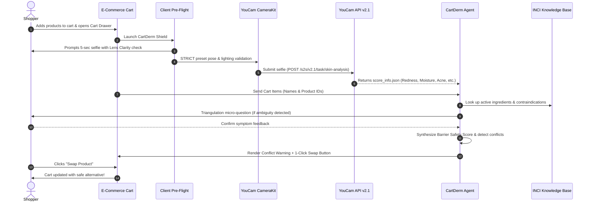

# 🌟 CartDerm — North Star & Product Blueprint

> **"The Grammarly for Skincare E-Commerce"**  
> *Preventing skin barrier damage and retail return waste right before the user clicks "Place Order".*

---

## 1. Product Vision & The "Moment"

Consumers rarely wonder about their skin in the abstract. They wonder **right before making a purchase**—standing in an online checkout queue holding $150 worth of trending serums, wondering:
* *"Will this 10% Glycolic Acid break me out?"*
* *"Is my skin barrier healthy enough for this retinol right now?"*
* *"Can I safely mix this serum with the moisturizer already in my cart?"*

**CartDerm** is an Agentic E-Commerce Guardian. Integrated as a Shopify storefront widget or browser shopping companion, CartDerm executes a **5-second front-camera optical check**, calls the **YouCam HD AI Skin Analysis API (v2.1)**, evaluates the shopper's active skin barrier condition, and cross-analyzes every INCI chemical ingredient in their shopping cart. 

If an item poses an active risk of irritation, barrier breakdown, or chemical contraindication, the **CartDerm Autonomous Agent** steps in with real-time triangulation, a Diagnostic Confidence Score, and a **1-click personalized product swap** to save their skin and secure the merchant's sale.

---

## 2. Pseudo-Image / UI Product Mockup

Below is the design layout and user flow of CartDerm running on an e-commerce checkout page:

```
┌────────────────────────────────────────────────────────────────────────────────────────────────────────┐
│  SEPHORA / GLOW RECIPE STOREFRONT                                               [Cart (3)] [Account]   │
├────────────────────────────────────────────────────────────────────────────────────────────────────────┤
│                                                                                                        │
│   SHOPPING CART (3 ITEMS)                                      ┌───────────────────────────────────┐   │
│   ──────────────────────────────────                           │   🛡️ CartDerm Barrier Guard       │   │
│   1. The Ordinary Glycolic Acid 7% Toning Solution             │   Status: [ ACTIVE PROTECTION ]   │   │
│      $13.00 • Exfoliating Toner                                ├───────────────────────────────────┤   │
│                                                                │  📷 LIVE OPTICAL SCAN             │   │
│   2. Paula's Choice 1% Retinol Treatment                       │  ┌─────────────────────────────┐  │   │
│      $62.00 • Targeted Treatment                               │  │      [  ( •  ‿  • )  ]      │  │   │
│                                                                │  │   Face Ratio: 72% [OK]      │  │   │
│   3. CeraVe Foaming Facial Cleanser                            │  │   Lighting Luma: 0.84 [OK]  │  │   │
│      $18.00 • Daily Cleanser                                   │  │   Lens Clarity: 94% [CLEAR] │  │   │
│                                                                │  └─────────────────────────────┘  │   │
│   ──────────────────────────────────                           │  Diagnostic Confidence: 89% (HIGH)│   │
│   Subtotal: $93.00                                             ├───────────────────────────────────┤   │
│   Estimated Shipping: FREE                                     │  🧬 YOUCAM v2.1 SKIN METRICS      │   │
│                                                                │  • Redness (Erythema):   58/100 ⚠️│   │
│   ┌────────────────────────────────────────────────────────┐   │  • Hydration (Moisture): 41/100 ⚠️│   │
│   │ [ PROCEED TO CHECKOUT ]                                │   │  • Oiliness (T-Zone):    68/100   │   │
│   │ ⚠️ CartDerm has detected 1 severe barrier conflict     │   │  • Skin Barrier Type: Combination │   │
│   │    Review recommendation before purchase               │   │    & Compromised Redness          │   │
│   └────────────────────────────────────────────────────────┘   ├───────────────────────────────────┤   │
│                                                                │  🤖 AGENTIC TRIANGULATION QUESTION │   │
│                                                                │  "Our scan detected elevated      │   │
│                                                                │   erythema (redness) on cheeks.   │   │
│                                                                │   Are your cheeks actively        │   │
│                                                                │   stinging or hot right now?"     │   │
│                                                                │   [ Yes, stinging ] [ No, warm rm]│   │
│                                                                ├───────────────────────────────────┤   │
│                                                                │  🚨 INGREDIENT CONFLICT DETECTED  │   │
│                                                                │  Item: Paula's Choice 1% Retinol  │   │
│                                                                │  Risk: High Risk of Retinoid Burn │   │
│                                                                │  Cause: Current moisture (41) +   │   │
│                                                                │  redness (58) + concurrent 7%     │   │
│                                                                │  Glycolic Acid will cause severe  │   │
│                                                                │  stratum corneum peeling.         │   │
│                                                                ├───────────────────────────────────┤   │
│                                                                │  ✨ 1-CLICK RECOMMENDED SWAP      │   │
│                                                                │  Swap Retinol 1% ($62.00) with:   │   │
│                                                                │  "Skin1004 Centella Ampoule +     │   │
│                                                                │   5% Niacinamide Barrier Serum"   │   │
│                                                                │  Price: $24.00 (Saves $38.00)     │   │
│                                                                │  Barrier Match Score: 98%         │   │
│                                                                │                                   │   │
│                                                                │  [ 🔄 ONE-CLICK SWAP IN CART ]    │   │
│                                                                └───────────────────────────────────┘   │
└────────────────────────────────────────────────────────────────────────────────────────────────────────┘
```

---

## 3. Value Proposition

### For the Consumer
* **Zero Barrier Disasters**: Eliminates chemical burns, peeling, and breakouts caused by incompatible actives.
* **Cost & Anxiety Protection**: Halts impulse purchases of viral products that aren't suitable for their current skin state.
* **Empowered Confidence**: Replaces guesswork with objective YouCam AI metrics and transparent agent reasoning.

### For the Retailer / Merchant
* **Drastic Return-Rate Reduction**: Skincare return rates exceed 20% due to "irritation/breakouts". CartDerm intercepts these before shipment.
* **Cart Abandonment Prevention**: Instead of shoppers leaving the site to Google ingredient conflicts, CartDerm provides instant resolution right in the cart drawer.
* **Higher Conversion & LTV**: Builds brand loyalty as a trusted advisor, shifting revenue to high-margin barrier-repair essentials.

---

## 4. Core User Journey



---

## 5. The Hardware Resilience Strategy (Winning Advantage)

To prevent cheap camera sensors, oily lens smudges, and warm room lighting from skewing diagnoses:
1. **Pre-Flight Lens Clean Reminder**: Prompts user to wipe lens and verifies basic Laplacian edge sharpness.
2. **Diagnostic Confidence Rating**: Displays an 80–100% confidence gauge based on CameraKit lighting luma uniformity.
3. **Agentic Triangulation**: The LLM agent dynamically arbitrates color-sensitive metrics (`hd_redness`, `hd_moisture`) with a single quick verification question before giving high-stakes recommendations.

---

## 6. Hackathon Success Metrics (Devpost Alignment)

| Criteria | Target Execution in CartDerm |
| :--- | :--- |
| **Technological Implementation** | Live REST integration with YouCam API v2.1 (`/task/skin-analysis`), async polling, handling JSON responses, CameraKit integration. |
| **Design & Coherence** | Complete, beautiful e-commerce cart drawer with smooth animations, clear alert hierarchy, and intuitive swap interaction. |
| **Potential Impact** | Solves a multi-billion-dollar beauty retail pain point: product returns and consumer skin barrier damage. |
| **Quality of Idea** | Moves far beyond a passive selfie score analyzer into an **autonomous pre-purchase agentic decision engine**. |
